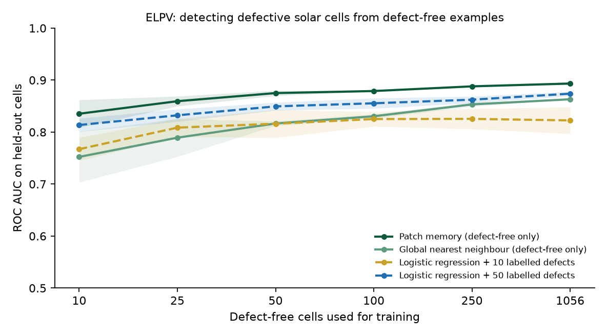

# Detecting defective solar cells from defect-free examples

A short, reproducible study on [ELPV](https://github.com/zae-bayern/elpv-dataset): 2,624 electroluminescence images of single solar cells from 44 modules, each annotated by experts with a defect probability of 0, 1/3, 2/3 or 1.

**Question.** Defect labels on a solar plant are expensive: someone has to image the panels and an expert has to mark the faults. Defect-free cells are cheap. Can a detector learnt from defect-free cells alone compete with one trained on labelled defects, and how many defect-free cells does it need?

**Finding.** A PatchCore-style patch memory built only from defect-free cells reaches **ROC AUC 0.893**, above logistic regression on the same features given **50 labelled defects (0.874)** or 10 (0.823). It already reaches 0.875 with 50 defect-free cells. Its scores also follow expert uncertainty: cells the annotators marked 1/3 sit between defect-free and defective cells (median score percentile 37.5, against 28.6 and 77.2).



| Defect-free training cells | Patch memory (defect-free only) | Global nearest neighbour (defect-free only) | Logistic regression + 10 labelled defects | Logistic regression + 50 labelled defects |
|---|---|---|---|---|
| 10 | 0.835 ± 0.027 | 0.752 ± 0.049 | 0.767 ± 0.022 | 0.814 ± 0.013 |
| 25 | 0.859 ± 0.010 | 0.789 ± 0.036 | 0.809 ± 0.017 | 0.832 ± 0.012 |
| 50 | 0.875 ± 0.005 | 0.817 ± 0.004 | 0.816 ± 0.027 | 0.850 ± 0.008 |
| 100 | 0.879 ± 0.001 | 0.830 ± 0.004 | 0.825 ± 0.014 | 0.855 ± 0.010 |
| 250 | 0.888 ± 0.001 | 0.853 ± 0.004 | 0.825 ± 0.020 | 0.862 ± 0.006 |
| 1,056 (all) | 0.893 ± 0.002 | 0.863 ± 0.000 | 0.823 ± 0.026 | 0.874 ± 0.004 |

Mean ± standard deviation over three random draws of the training cells. The supervised columns use the same defect-free cells plus the labelled defects.

| Patch memory, all defect-free cells | ROC AUC |
|---|---|
| Monocrystalline cells | 0.939 |
| Polycrystalline cells | 0.876 |

| Expert annotation | Median score percentile |
|---|---|
| 0 (defect-free, held out) | 28.6 |
| 1/3 (uncertain) | 37.5 |
| 2/3 and 1 (defective, held out) | 77.2 |

## Why it matters

On a large solar plant, defect-free images arrive by the thousand from every inspection, while confirmed defects are few and need an expert. A detector that needs only normal examples can be set up on a new plant, panel type or camera without waiting for a labelled defect set. Polycrystalline cells, whose grain texture looks like damage to a generic model, are where it is weakest, which suggests where the next improvement should come from.

## Method

- **Features:** frozen ImageNet Wide ResNet-50-2, layers 2 and 3, each locally averaged over 3 × 3 neighbourhoods and aligned to a 14 × 14 grid (196 patches of 1,536 dimensions per cell), as in PatchCore (Roth et al., CVPR 2022). Grey-scale images are repeated to three channels and resized to 224 × 224.
- **Patch memory (defect-free only):** a bank of patch features from N defect-free cells; a cell's score is the largest distance from any of its patches to the nearest patch in the bank.
- **Global nearest neighbour (defect-free only):** one averaged feature per cell; score = distance to the nearest of the N defect-free cells.
- **Few labels (supervised):** logistic regression (C = 0.1, balanced classes) on the averaged features, trained on the same N defect-free cells plus k labelled defective cells.
- **Split** (fixed, seed 0, stratified by cell type): 70% of defect-free cells form the training pool (1,056) and 30% are test normals (452). Defective means probability 2/3 or 1; 30% of them form the pool of labels for the supervised method (247) and 70% are test defects (574). The 295 cells marked 1/3 are kept out of training and testing and scored separately.
- **Simplifications for a CPU:** patch features are reduced to 256 dimensions by a fixed random projection, and the memory bank is a random subset of at most 20,000 patches. PatchCore uses greedy coreset selection instead, so these numbers are a lower bound for the full method.

## Limitations and next steps

- Electroluminescence images are taken in the dark under forward current, one cell at a time. Drone inspection of a desert plant uses visible and thermal images of whole panels under sun, soiling and glare, which is a harder setting.
- One dataset with 44 modules. A split by module, rather than by cell, would test whether the detector carries over to panels it has never seen.
- Next steps: coreset selection and full-dimensional features; localisation maps to show the operator where a defect is; a soiling dataset such as DeepSolarEye (Mehta et al., WACV 2018) to separate dirt, which needs cleaning, from damage, which needs replacement.

## Reproduce

```bash
python -m venv .venv
.venv/Scripts/pip install -r requirements.txt   # macOS/Linux: .venv/bin/pip
python run_experiment.py
```

The `elpv-dataset` package downloads the images. About nine minutes on a laptop CPU; everything is written under `results/`.

## References

- Buerhop-Lutz, C., Deitsch, S., Maier, A., Gallwitz, F., Berger, S., Doll, B., Hauch, J., Camus, C., Brabec, C. J. *A Benchmark for Visual Identification of Defective Solar Cells in Electroluminescence Imagery.* EU PVSEC 2018.
- Deitsch, S., Christlein, V., Berger, S., Buerhop-Lutz, C., Maier, A., Gallwitz, F., Riess, C. *Automatic Classification of Defective Photovoltaic Module Cells in Electroluminescence Images.* Solar Energy 185, 2019.
- Roth, K., Pemula, L., Zepeda, J., Schölkopf, B., Brox, T., Gehler, P. *Towards Total Recall in Industrial Anomaly Detection.* CVPR 2022.
- Zagoruyko, S., Komodakis, N. *Wide Residual Networks.* BMVC 2016.

Abdullah Mohammed Siraj, 2026. Code under the MIT licence. The ELPV data belongs to its authors (CC BY-NC-SA 4.0) and is not included here.
